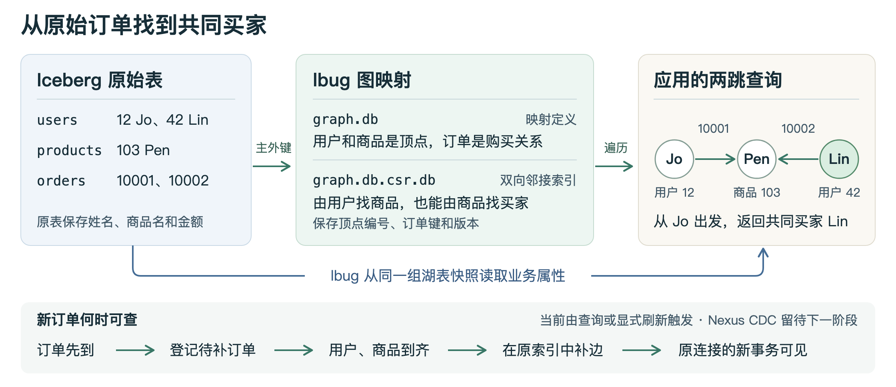

# 在原始 Iceberg 表上运行 Cypher 图查询

这个 POC 把用户、订单、商品三张湖表映射成一张购买关系图。应用可以用 Cypher 查“还有谁买过同款商品”，lbug 沿双向邻接索引（CSR）找买家，再从同一组 Iceberg 快照读取姓名、商品名或金额。



端点可能迟到的纯追加用例使用 `schema-stable.cypher`，在原独立库上补边。`schema.cypher` 在读事务内临时建索引，`schema-sidecar.cypher` 按快照持久化索引。这三种模式接受相同的 `MATCH` 查询。复现实验使用本地文件和 PyIceberg 的 SQLite catalog。

在上游 `main` 的 `71f38adf2` 上编译后，1 亿笔订单的三跳查询取完 4,476 行，后续 5 次中位数为旧外表 JOIN 3.98 秒、已建 CSR 0.50 秒。四跳取完 224,056 行，分别为 8.22 秒与 4.82 秒。两边均用 10 个 DuckDB 读湖线程。架构文档 `docs/iceberg_graph_mapping_phase1.md` 第 8.5 节列出两跳到四跳的首次耗时及峰值内存。

```cypher
MATCH (u:User)-[o:Purchased]->(p:Product)
RETURN o.oid, u.uid, u.uname, p.pid, p.pname, o.amt ORDER BY o.oid;
```

## 复现

映射格式和 CSR 读写编入 liblbug，在打开数据库、恢复 catalog 之前注册。首次创建和再次打开均可直接运行 `lbug graph.db`。每条新连接通过 `CALL iceberg_poc_catalog=...` 指定读湖 catalog。已有映射数据库沿用原格式及独立 CSR 文件。

每条连接可以设置映射表读湖时的 DuckDB 线程数，默认值为 1。例如在同一连接中执行以下两句，再运行原来的 `MATCH`。

```cypher
CALL iceberg_scan_threads=4;
CALL current_setting('iceberg_scan_threads') RETURN *;
```

自动提交模式下，下一条读湖查询即使用新值。显式事务在第一次访问湖表时创建读湖器，此后该事务复用它。设置作用于读拓扑键和按 CSR 命中键取属性时的 DuckDB 扫描。lbug 的 `threads` 控制图执行器。开启 `LBUG_ICEBERG_POC_PROFILE=1` 后，日志里的 `duckdb_threads` 显示读湖器实际使用的线程设置。

构建使用 C++20、SQLite 开发文件和 DuckDB SDK。原生 64 位构建检测到 DuckDB 的 CMake 包或指定了 `DUCKDB_DIR` 时，默认编入映射后端。下面显式启用该功能；没有 SDK 时，macOS 和 Linux x86-64/ARM64 构建会下载锁定的 DuckDB 1.5.5。可用 `-DDUCKDB_DIR=/path/to/sdk` 指定与本机 DuckDB CLI 一致的 SDK。已验证 1.5.5 和 2.0.0。DuckDB 读湖时使用与其版本匹配的 Iceberg/Avro 扫描组件；在同一个进程里使用 DuckDB Python 绑定做对照的规模基准固定在 1.5.5。

```bash
export LBUG_BUILD="$PWD/build/lake-lbug"
cmake -S . -B "$LBUG_BUILD" -G Ninja -DCMAKE_BUILD_TYPE=Release -DENABLE_ICEBERG_MAPPING=ON -DBUILD_EXAMPLES=ON
cmake --build "$LBUG_BUILD" --target lbug_shell
duckdb -no-init -c "INSTALL avro; INSTALL iceberg;"
export LBUG_C_API_LIB_PATH="$LBUG_BUILD/src/liblbug.dylib"  # Linux 使用 liblbug.so
uv run --python 3.13 --script examples/iceberg-query-csr/run.py \
  --output "$PWD/build/iceberg-csr-poc/runs"
```

每次运行在输出目录下创建独立的 `run-*`，保留原始 Iceberg warehouse、catalog 和 `results.json`。省略 `--output` 则使用自动清理的临时目录。脚本使用当前仓库 `tools/python_api` 的 C API 绑定。

## 将映射关系的 CSR 保存在独立文件

在前述构建环境中执行以下命令。它建立一个包含原生表和映射表的磁盘库，并在独立进程中测试重开。

```bash
uv run --python 3.13 --script examples/iceberg-query-csr/sidecar.py \
  --output "$PWD/build/iceberg-csr-poc/runs"
```

| 位置 | 持久化内容 |
|---|---|
| 原始 Iceberg 表 | 用户、商品、订单及全部业务属性 |
| `graph.db` | 映射 DDL 以及普通原生图表的数据、索引和 CSR |
| `graph.db.csr.db` | 稠密编号表 `CsrSlots`、原生双向关系表，以及纯追加后各快照的可见范围 `CsrVersions`。每条边保存顺序号 `lake_row` 和回查用的原始订单键 `lake_key` |

首次使用映射关系时，映射后端固定三张湖表的版本，将业务键映射为稠密 offset，把两个端点和两种定位信息送给原生 `COPY`。lbug 在独立文件的一次写事务内构建和发布新关系表。遍历走 `OnDiskGraph` 的正反向邻接读取。普通原生表沿主库原有路径读写，在本节的 `iceberg_csr` 模式下，只查询映射节点无需打开 CSR 文件。稳定编号模式读取顶点时还会访问独立库里的顶点字典。

缓存键包含三张表的 UUID、snapshot ID、schema ID、表与端点映射及定位格式版本。同一组快照跨事务、进程重启后均可命中。仅表属性等元数据变动且快照、schema 不变时也可命中。已有索引的订单表发生纯追加时，可以在原关系表上发布增量。端点表换快照、订单更新或删除时，普通查询仍会全量构建独立版本。已固定快照的旧事务继续使用自己的邻接。原有映射扫描通过 DuckDB 读取并按键排序所请求的整列。启用下文的 DataFusion 计划后，符合条件的一跳查询可以把属性过滤送入 Iceberg。

旧版独立文件只含 `lake_row`。首次使用新版映射关系时会为当前快照建立一份含 `lake_key` 的 CSR，历史版本可以共存。新版独立库的缓冲池设为 256 MiB，供原生 `COPY` 构建双向关系及两个定位列。

验证脚本覆盖同快照复用、并发首次构建、旧事务跨提交、固定与变长两跳、增删改、重复键失败、空关系、超过一个向量批次的邻接表，以及同一条查询中的原生关系和映射关系。它还暂时移走独立文件，在新进程中只查询原生关系，然后恢复文件并验证映射关系命中。`checks.json` 保存逐行 JOIN 对照，`physical.json` 保存主库、独立文件的表和实际 CSR 页信息。

新进程直接打开含映射的主库时，内核先注册映射存储后端，再恢复 catalog。此 PoC 保留已提交的历史 CSR 版本，连续更新会使独立文件增长。验证使用本地文件和单进程多连接。

旧版仅含 `lake_row` 的独立文件在 M1 Max 上用本地百万笔订单、单线程和相同快照实测。单用户取 10 笔订单的六列属性，首次建库并返回结果用时 1.31 秒，后续新事务命中 CSR 的中位数为 266 毫秒。若每次临时建图，相同查询为 374 毫秒。从同一用户沿商品找其他购买者、只返回两跳路径计数时，新事务命中为 41 毫秒，每次临时建图为 247 毫秒。两种查询各重复 5 次，结果分别与对应快照的 SQL JOIN 核对。在仅含映射定义的基准库中，主文件为 16 KiB，独立文件含一个 CSR 版本时约为 24.3 MiB。

## 用 DataFusion 执行一跳映射查询

使用前述 lbug 和 DuckDB 构建目录，另需 Rust（实测 1.95）和 Cargo。从仓库根目录运行，`--benchmark-edges` 可省略。

```bash
cmake -S . -B "$LBUG_BUILD" -DENABLE_ICEBERG_DATAFUSION=ON
cmake --build "$LBUG_BUILD" --target lbug_shell
uv run --python 3.13 --script examples/iceberg-query-csr/datafusion_check.py \
  --output "$PWD/build/iceberg-csr-poc/runs" --benchmark-edges 1000000
```

对 `schema-sidecar.cypher` 中的映射正常发起查询即可。以下查询从一个已知用户展开订单，再按金额筛选并取订单号最小的三笔。

```cypher
MATCH (u:User)-[o:Purchased]->(p:Product)
WHERE u.uid = 351001 AND o.amt < 4900
RETURN o.oid, o.amt ORDER BY o.oid LIMIT 3;
```

lbug 的 `EXPLAIN` 显示 `DATAFUSION_ICEBERG_MATCH` 表示这条查询已被翻译。在进程环境设置 `LBUG_ICEBERG_DF_TRACE=1` 可打印当前订单快照以及实际的 DataFusion 逻辑、物理计划。执行器用原生 CSR 遍历命中端点的邻接表，生成候选边键。Rust Iceberg provider 读取该事务固定的订单 metadata 文件，投影订单键、端点外键及所需属性，同时接收端点与金额谓词。DataFusion 按边键连接两路结果，执行排序及限制。即使湖中留有指向已删除商品的订单，CSR 成员资格仍决定这笔订单能否进入结果。

自动翻译覆盖单个有向 `MATCH`，起点或终点主键等值、可选的单个 `INT64` 边属性小于阈值、投影 `INT64` 边属性、按唯一边键升降序及可选的字面量 `LIMIT`。其余形状交给原 lbug 规划器。设置 `CALL iceberg_poc_datafusion=false` 可在同一连接测试原路径。初建 CSR 和查找起点的稠密编号仍使用原有 DuckDB 读键逻辑。

检查脚本在一个连接上跨 Iceberg 提交逐行对照固定快照的三表 JOIN。`plan.txt` 保存小样本的实际计划，`bench/plan.txt` 保存基准查询的实际计划和候选边数，`results.json` 记录正确性和计时。测速交替运行同一条 Cypher 的两种计划以及常驻 DuckDB 连接上的原表 JOIN。两个图计划在每次查询时开启新事务，使用同一个已建好的 CSR。SQL 对照直接使用已解析的三个快照，计时包含结果取回。

在 M1 Max 本地用固定种子生成 100 万笔订单、10 万个用户和 2 万个商品，以上查询从 CSR 展开 10 条边并返回 3 行。两轮独立测试各预热一次、交替测量 7 次，两轮中位数分别为 DataFusion 映射查询 47.1 和 74.7 ms，原映射查询 244.5 和 336.3 ms，原表三表 JOIN 20.7 和 25.6 ms。包含首次构建 CSR 的 DataFusion 查询分别为 1.34 和 1.38 秒。

## 一亿笔订单的多跳基准

沿用上文启用了 DataFusion 的内核及其 `LBUG_C_API_LIB_PATH`。在新目录下运行以下命令会保留三张 Iceberg 表、映射主库、独立 CSR、查询结果和内存采样。生成器给每个用户分配 10 笔订单，再把订单随机打散写入 100 个 Parquet 文件。

```bash
EXAMPLE="$PWD/examples/iceberg-query-csr"
RUN=$(mktemp -d "$PWD/build/iceberg-csr-poc/runs/ecom-100m-XXXXXXXX")
mkdir -p "$RUN/build-metrics"
uv run --python 3.13 --script "$EXAMPLE/large_fixture.py" "$RUN/lake" --edges 100000000
uv run --python 3.13 --script "$EXAMPLE/large_build.py" "$RUN" map \
  --profile "$RUN/build-metrics/map"
uv run --python 3.13 --script "$EXAMPLE/large_build.py" "$RUN" native \
  --buffer-gib 6 --profile "$RUN/build-metrics/native"
uv run --python 3.13 --script "$EXAMPLE/large_suite.py" "$RUN" \
  --repeats 5
```

这套基准单独预构建全新的 CSR 文件。DuckDB 从固定快照读取拓扑键，外部排序并检查唯一性，按源节点编号分批。lbug 的原生 `COPY` 写入双向关系，每一批 checkpoint 并关闭写库。构建脚本重开库核对边数后发布文件。查询使用内核的映射存储后端，与按需构建共用快照缓存键、稠密编号、`lake_row` 和 `lake_key`。临时排序和分批文件只用于构建。此流程适用于一个新的基准目录。

每个查询、每种事务模式各使用一个独立进程。首次执行和之后五次的耗时分别记录，包括 Cypher 规划、执行和取完结果。自动提交模式下每次执行开启新事务，显式读事务模式下复用事务内的键列。脚本用原始快照的逐跳 JOIN 校验所有结果，也检查实际打开的 CSR 版本。macOS 上由父进程每 20 ms 采样 RSS 和 physical footprint，内存测量包含查询绑定及嵌入式引擎。每次执行、内存样本和物理计划保存在 `queries/`，汇总位于 `results.json`。

在 32 GiB M1 Max 上，两段构建的进程墙钟合计 259 秒，独立文件为 3.791 GiB，成功构建峰值 RSS 为 3.92 GiB。固定起点的四跳计数返回 229,213 条路径，新事务中位数为 916 ms，同一事务重复查询为 138 ms。固定查询统一使用 2 GiB 主库缓冲池和 256 MiB 独立库缓冲池。

给 `large_suite.py` 增加 `--rotation` 可在同一读事务中依次查询不同用户。默认独立库缓冲池在四跳访问第 2 个新用户时报告缓冲池耗尽，前序已返回的结果也会保存。单独将 `native_csr.cpp` 的独立库缓冲池调到 1 GiB 后，同一组 12 个新用户全部通过对应的快照 JOIN 对照，四跳中位数为 453 ms。构建文件和原始湖表可以在两种读取配置之间复用。

## 订单纯追加和异步刷新

保持 users、products 的快照和映射不变。对于 Iceberg v2 的无删除文件的 append，映射后端沿父快照查找已索引的版本，通过父子快照的活跃文件清单找出新数据文件。从新 Parquet 按 Iceberg field ID 只读订单键和两个端点键。端点的有序整数主键按固定 metadata 文件缓存在内存中，同一映射数据库中的查询和刷新共用。首次加载 1,000 万用户和 200 万商品需要约 92 MiB 的整数数组空间。

同一笔 lbug 独立库写事务用原生关系 `CREATE` 写入双向邻接，并在 `CsrVersions` 登记快照版本、可见顺序号上限及有效边数。读事务即使在后续追加完成后才首次遍历关系，也能按旧版本读取。普通图查询自动补齐尚未索引的连续追加快照；另一个连接也可以显式请求刷新到指定的订单快照。函数返回该快照和有效边数，重复调用复用已有结果。

```cypher
CALL iceberg_csr_refresh('Purchased', 1234567890123456789)
RETURN snapshot_id, edge_count;
```

上例中的整数要替换为 Iceberg 订单表真实的 snapshot ID。刷新需要已有兼容的基础 CSR，目标位于当前保留的快照祖先链上。新订单号大于历史上界时可直接追加。订单号交错时，映射后端在原生关系表检查历史键冲突，通用扫描按订单键恢复当前快照的排序行号。如果历史订单含缺端点的行而原生拓扑无法证明键唯一，或遇到更新、删除、端点快照变化及不兼容格式，刷新会返回需要全量构建的错误。增量写入后的文件需要用支持 `CsrVersions` 的扩展读取。

对前一节生成的一亿订单基准，以下命令为每次测量建立独立的 catalog 和图文件副本，保留原始基准。每个副本实际追加 100 笔，验证同一服务连接、同一主库及同一物理关系表，检查反向邻接、旧事务、重复刷新，再逐行核对同快照三表 JOIN。默认预热两张端点表的键，增加 `--cold-keys` 可测首次加载端点键的耗时。每轮均保存毫秒计时、内存样本、快照和结果。

```bash
uv run --python 3.13 --script examples/iceberg-query-csr/append_benchmark.py \
  "$RUN" "$RUN/append-warm" --trials 5
```

在本地 M1 Max（32 GiB），100,000,000 笔订单上追加同一用户的 100 笔，均关联已有商品。计时从 Iceberg 提交返回开始，终点为原服务连接取完 100 行订单 ID 和金额。两种端点索引状态分开测量，每轮从独立的原始一亿行副本开始。

| 路径 / 中位数 | 端点主键已缓存（5 轮） | 端点主键首次加载（3 轮） |
|---|---:|---:|
| 普通图查询触发追加，提交至取完结果 | 96.2 ms | 457.6 ms |
| 独立连接立即刷新，提交至刷新返回 | 88.5 ms | 441.9 ms |
| 刷新成功后，原连接查询耗时 | 35.2 ms | 39.1 ms |
| 独立连接立即刷新，提交至原连接取完结果 | 123.7 ms | 483.5 ms |

热端点下查询触发的增量构建及原生提交中位数为 57.6 ms。每次实测读取一个新订单文件，写入 100 条原生关系。独立文件关闭后增加 1,323,008 字节，其中包括首次创建版本表的开销。冷端点指进程内两张主键索引未加载，操作系统文件缓存未清空。上述计时均未接入 Nexus 的调度、网络与对象存储。

## 稳定顶点编号和迟到端点

`schema-stable.cypher` 把三张表注册为 `iceberg_stable_csr`。这是独立的追加型映射格式，沿用同一主库和 `graph.db.csr.db`。首次启用时，若独立文件已有当前三表快照的原生 CSR，尚未由旧版追加模式维护、既有边覆盖所有订单，且两端仍使用基线的排序编号，映射后端会接管并重命名这张关系表，保留其表 ID 和已有邻接。没有可接管的基线时，首次遍历从原表建立初始拓扑和待补订单。

- 顶点初始编号等于各自基线的主键排序位置。从此每个 append 批次只将新键放到该顶点类型的末尾。独立库以 `INT64[]` 持久化各批的键和顺序，读事务按固定快照取得可见前缀。扫描顶点属性时用稳定编号反查业务键在相应 Iceberg 快照中的位置。
- 缺端点的订单以 `oid` 为主键在独立库记录两端业务键与订单定位符。每个缺失的用户或商品键有一个带主键索引的等待记录，可通过其原生邻接找到相关订单。新顶点到达时，只处理等待该键的订单。两端齐全后，在同一写事务里写原生双向边、清除待补记录并发布三表快照组合。属性继续从原始 Iceberg 读取。
- 普通图查询可以直接触发补边。`CALL iceberg_csr_refresh('Purchased', 订单快照ID)` 也会使用当前读事务固定的用户和商品快照。重复请求相同三表版本会复用已发布结果。旧读事务按订单顺序号和两端当时的顶点编号范围读取。该 POC 的增量范围是同一身份和 schema 的 Iceberg v2 纯追加表。

用户和商品分别从 0 分配 `int64_t` 编号。业务主键只用于查字典，主键值达到 `INT64_MAX` 也只占一个编号。原生关系表从 `2^62` 起分配事务内临时关系偏移。稳定映射据此把每张输入表的行数上限设为 `2^62`，最后一个可分配的顶点编号为 `2^62 - 1`。刷新时若任一输入快照超限，查询会报告容量错误，独立库保留已发布的 CSR 版本。

复现需要上一亿行基准目录（上文的 `$RUN`）、本地 PyIceberg SQLite catalog，以及启用 DataFusion 的内核构建。计时的三列键查询使用 lbug 的原生关系遍历，另用 DataFusion 一跳查询核对金额。脚本为每轮新建独立可写的三表 catalog 和映射主库，并复制基线 CSR。原始基准目录可以复用。该基准始终保持同一服务连接，使用 100 个穿插在旧主键之间的新用户键及 100 个新商品键，每个订单使用不同的一对端点。最终计时从最后一次 Iceberg append 提交返回开始，到该连接一次普通 MATCH 取完全部 100 组用户、订单、商品 ID 为止。每个阶段另用固定三表快照做全量 JOIN 计数，逐行比对目标结果和一组旧边，并检查顶点编号。原生关系表 ID、阶段数据、查询计划与进程内存样本保存在每轮结果目录。

```bash
uv run --python 3.13 --script examples/iceberg-query-csr/late_endpoints_benchmark.py \
  "$RUN" "$LBUG_BUILD/runs/late-endpoints" \
  --trials 3
```

在本地 M1 Max（32 GiB）的三个独立一亿行副本上，中位数如下。已有 CSR 的原生关系表 ID 在三轮中均保持为 2。旧用户主键 694064 和 694071 的编号分别保持为 99009、99010，中间插入的 694065 分配到 10000000。

| 测量项 | 中位数 |
|---|---:|
| 一次性建立 1,200 万个旧顶点的编号字典并接管原有 CSR | 17.51 秒 |
| 100 个新商品提交返回，到原生 CSR 补边事务提交 | 148.7 ms |
| 其中补边的原生关系事务 | 103.6 ms |
| 同次商品提交返回，到原连接取完 100 行查询结果 | 736.7 ms（733.6–795.6 ms） |

订单入湖后，原连接先显式刷新以记录 100 笔待补订单。用户入湖时仍有 100 笔待补；商品入湖后，首条普通查询触发补边，100 条全部可见。两个顶点阶段均读取 0 个订单数据文件。最终关闭后独立文件合计增长 27,242,496 字节，包含旧顶点编号字典和等待索引。本地计时不含 Nexus 轮询及远端对象存储。

## 事务内临时 CSR 的读取路径

- `schema.cypher` 中的 `PRIMARY KEY` 映射湖表节点键。`ecom.orders KEY oid FROM uid TO pid` 指定订单标识和两个端点，属性按同名列绑定。三条 DDL 只登记映射。
- 第一次访问映射表时，通过同一次只读目录查询固定各表不可变的 Iceberg metadata 文件。所有后续扫描都通过 DuckDB 的 `iceberg_scan(metadata_file)` 读取相应快照。
- 需要遍历关系时，C++ 后端读取节点键和边的三个键，为节点分配当前快照内的 offset，按度数计数、前缀和、填充得到正反向 CSR。每条邻接项记录邻居 offset 和边的行号。多笔订单可以共享同一对端点；任一端点缺失的订单与 SQL 内连接一样被排除。
- 遍历由 lbug 的节点/关系扫描算子执行。查询需要的属性列才会从原表投影读取，按唯一键排序后与 CSR 的行号对齐。CSR、键和读到的属性列均由 lbug 事务缓存持有，事务结束后释放。没有向原生表写入数据或生成 Icebug 文件。

## 验证方法和范围

`run.py` 创建 `users`、`products`、`orders` 三张 Iceberg v2 表。它用一个 lbug 连接执行八次相同的 `MATCH`，把六列有序结果逐行与独立 DuckDB 进程执行的原表三表 JOIN 和预期行比较。JOIN 显式指定每张表的 metadata 文件和 snapshot ID。自动提交对照检查查询前后的目录指针一致；跨提交的读事务使用首次读取时记录的旧快照集合。lbug 构建每份 CSR 时也会输出三条实际读取的 metadata 路径。

用例覆盖平行订单、新增用户/商品/订单、节点与边属性修改、两个端点迁移、订单删除和目标商品删除。额外的读事务跨过一次写入，验证仍可读到旧图，结束后下一条查询读到新图。结果文件保留每轮的快照、MATCH 行和 JOIN 行。

当前实现使用唯一非空的 64 位整数键，属性支持 64 位整数和字符串。查询会读取相关表的全部键，对请求的属性也会读取整列并按键排序。一次目录读取给出各表的快照组合，跨表写入的业务原子性由写入端决定。

## 查询耗时

在上面的构建环境中运行以下命令。

```bash
cmake --build "$LBUG_BUILD" --target iceberg_query_bench
uv run --python 3.13 --script examples/iceberg-query-csr/benchmark.py \
  --build "$LBUG_BUILD" --output "$PWD/build/iceberg-csr-poc/runs" --after-commits
```

默认构造 1 万、10 万和 100 万笔订单，每个用户 10 笔，订单按固定随机顺序写入原始 Iceberg 表。每个规模分别执行返回所有订单和只返回一个用户订单的一跳查询。两种查询都投影六列，按订单 ID 排序。每个用例预热文件缓存，逐行核对 MATCH 和固定快照的 JOIN，然后在单线程 Release 构建上重复 5 次。可用 `--edges` 和 `--repeats` 调整规模和重复次数。

- `rebuild` 计时同一 lbug 连接上的自动提交查询，包含打开湖表读取器、确定最新快照和构建双向 CSR。
- `reuse` 计时同一显式读事务内的后续查询，复用该事务的 CSR 和已经读取的属性列。
- `join` 在常驻 DuckDB 连接上直接扫描相同的三份 Iceberg 快照，SQL 显式给出 metadata 路径和 snapshot ID。

上述三项均从提交查询计时至 C++ 接口返回物化结果，排除造数、结果打印和逐行比对。`--after-commits` 在另一份最大规模的数据集上保持一个 lbug 连接，每次向 Iceberg 提交一行新增、更新商品端点和金额、或删除后，立即计时第一个自动提交 MATCH 至返回结果。该用例通过 Python C API 发起查询，取行比对和 Iceberg 写入均在计时外。每次都用对应快照的 JOIN 校验完整结果。

`bench-*/results.json` 保留各轮样本、中位数和快照。设置环境变量 `LBUG_ICEBERG_POC_PROFILE=1` 可在每个规模的 `all/trace.log` 和 `one_user/trace.log` 查看打开读取器、扫描并排序、转换列值、构建双向邻接数组的分段耗时，单位均为毫秒。

给 `benchmark.py` 加 `--sidecar` 可以测试磁盘模式。`first_build_ms` 是第一次 MATCH 的单次耗时，包含原生 CSR 的构建和提交。`sidecar_hit` 是同快照新事务的命中耗时，`reuse` 额外复用同一读事务内的属性列。

## 在相同快照上复测旧外表与稳定 CSR

`foreign_join_benchmark.py` 适用于本示例的电商数据。准备 `large_fixture.py` 生成的 `$RUN/lake/fixture.json` 和 `catalog.sqlite`，以及按 `schema-stable.cypher` 定义、已在该快照建好 CSR 的 `$STABLE_GRAPH`。设置 `$DUCKDB_EXTENSION` 为与当前 lbug、DuckDB 1.5.5 匹配的旧外表连接器文件。旧连接器也可独立构建，映射表本身内置在 lbug 中。

从仓库根目录执行，沿用前文的 `LBUG_BUILD`、`LBUG_C_API_LIB_PATH`。线程设置辅助模块是共享库构建下的基准目标，设置并读回旧外表连接器实际使用的 DuckDB 线程数。

```bash
cmake --build "$LBUG_BUILD" --target iceberg_bench_reader
uv run --python 3.13 --script examples/iceberg-query-csr/foreign_join_benchmark.py \
  "$RUN" "$STABLE_GRAPH" "$RUN/foreign-join-comparison" \
  --extension "$DUCKDB_EXTENSION" \
  --reader-library "$LBUG_BUILD/examples/iceberg-query-csr/libiceberg_bench_reader.so" \
  --threads 10
```

选一个尚未创建的输出目录。脚本在输出目录中创建固定到三个快照的只读视图、用独立 SQL JOIN 计算有序对照明细，并将每条 Cypher、执行计划和六次测量保存到对应文件。每种方式、每个跳数单独起进程。计时包含客户端取完结果，以整进程 RSS 高水位作为峰值。每次计时结束后逐行核对四列及重复次数。上述命令已在 macOS 验证。

Apple M1 Max（32 GB）、本地文件、缓存预热后的一次实测如下。表内是单线程 5 次中位数，单位为毫秒。

| 订单数 | 返回行数 | 自动提交 MATCH | 事务内复用 MATCH | 同快照 DuckDB JOIN |
|---:|---:|---:|---:|---:|
| 10,000 | 10 | 38.1 | 0.50 | 2.91 |
| 10,000 | 10,000 | 40.7 | 4.04 | 4.26 |
| 100,000 | 10 | 69.4 | 0.69 | 5.38 |
| 100,000 | 100,000 | 113.4 | 39.1 | 17.1 |
| 1,000,000 | 10 | 375.8 | 3.01 | 19.5 |
| 1,000,000 | 1,000,000 | 795.6 | 417.6 | 173.6 |

百万笔订单上，同一连接在新增、修改和删除一笔订单后，首条单用户 MATCH 的中位数分别为 444、433 和 430 毫秒，15 次均与对应快照的 JOIN 一致。对静态百万边的单用户查询另做 5 次分段测量，扫描并排序约 173 毫秒，将列值转成 lbug Value 约 133 毫秒，构建双向邻接数组约 28 毫秒。
